<h3 align="center">AI Engineer | Generative AI | RAG Architect | Agentic AI Developer</h3>

  

---

## 🚀 About Me  
I am an **AI/ML Engineer** specializing in **Generative AI, Hybrid RAG systems, Agentic AI workflows, Vector + Graph Databases, and production-grade AI applications**.  
I build **intelligent, scalable AI systems** for enterprise use cases like **GRC, compliance automation, chatbot platforms, RAG-based search, and predictive analytics**.

Currently working at **Ascent Business Technology, Gurgaon** as an **AI Engineer**.

---

## 🔥 What I Do
- ⚙️ Build enterprise-grade **Hybrid RAG architectures** (Vector DB + Graph DB + Elasticsearch)  
- 🤖 Develop **AI Agents**, LLM-based workflows, and NLP-powered automation  
- 🔍 Implement multi-tenant **SaaS AI chatbot platforms** (FastAPI, LangGraph, Redis, RabbitMQ)
- 💳 Integrate **Razorpay & Stripe payment gateways** for secure subscriptions, billing, and SaaS payment workflows
- 📚 Fine-tune LLMs (LLaMA 7B, Mistral Large 3) using **LoRA/QLoRA**  
- 🧠 Create deep learning models for healthcare and predictive analytics  
- 🗄️ Design & optimize **ETL / ELTL pipelines** for unstructured data  
- 🔐 Implement **RBAC, secure data access** in api endpoints using keycloak, and enterprise search governance  

---

---

## 🛠️ Tech Stack

<!-- Languages -->

<!-- Databases -->

<!-- AI / ML / LLM -->

<!-- LLM / RAG / Agentic -->

<!-- ETL / Pipeline -->

<!-- BI Tools -->

<!-- Frameworks -->

<!-- DevOps / Tools -->

---

---

## 🛠️ Skills & Technologies

### **Programming**
Python | SQL | PostgreSQL | MS SQL | Cypher Query | JWT

### **AI & ML**
LLMs | RAG | Agentic AI | LangChain | LangFlow | LangGraph | Transformers | Unsloth
Deep Learning | Computer Vision | NLP | Scikit-Learn | TensorFlow | PyTorch | LLM Fine-Tuning | MCP | N8N
OpenAI | Azure AI Foundry |  AWS Bedrock | Anthropic Claude | Gemini | Groq | Ollama | HuggingFace

### **Data Tools**
MongoDB | ChromaDB | Neo4j | Postgres & pgvector | Redis Cache | 
Tableau | Power BI | Excel | Google Data Studio  
LlamaIndex | Airbyte | Airflow | ETL/ELTL Pipelines | RabbitMQ

### **Soft Skills**
Problem-Solving | Leadership | Team Management | Critical Thinking | Public Speaking

---

## 🚧 Work Experience

### **🔹 AI Engineer — Ascent Business Technology (Oct 2024 – Present)**  
- Developed **self-hosted intelligent chatbot platform** with Hybrid RAG  
- Built **Generative AI Compliance Engine** using Agentic workflows  
- Implemented **RBAC-based secure enterprise search**  
- Created **AI-driven NLP Query & Report Generator**  
- Worked on **GRC product’s AI layer** (risk assessment, regulatory mapping)  
- Designed **Hybrid ELTL pipelines** for PDFs, text & unstructured data  
- Fine-tuned **LLaMA & Mistral** models using LoRA / QLoRA  
- Implemented **risk prediction models** using regulatory/market data  

---

## 🧩 Featured Projects

### 🔥 **PlugAI Business – AI Service Platform**
**React + FastAPI + LLMs + JWT Auth + Scheduler + Analytics**  
- AI Assistant  
- Auto call scheduling (Google Calendar API)  
- News & Article Management CMS  
- Scalable backend + responsive UI

### 🤖 **Plug Chat – Multi-Tenant SaaS Chatbot Platform**
**RAG | Agentic AI | Multi-Tenant | Embeddable Widgets**  
- Create custom business chatbots  
- Document ingestion + website crawling  
- Tenant-isolated Vector/Graph DBs  
- Configurable LLM Providers  
- Third-party integrations  

### 🧠 **Alzheimer’s Disease Detection (CNN + Transfer Learning)**
Used **VGG16, VGG19, ResNet121, EfficientNet** for MRI classification & early diagnosis.

---

## 🎓 Certifications
- Applied Data Science Lab — *WorldQuant University*  
- Graph DB Certified Professional — *Neo4j*  
- Google AI/ML — *AICTE*  
- Microsoft Machine Learning Certification  

---

## 🌐 Connect With Me

## 📊 GitHub Stats

  <picture>
    <source media="(prefers-color-scheme: dark)" srcset="https://github-readme-stats.vercel.app/api?username=neetpalsingh&show_icons=true&hide_border=true&bg_color=0D1117&title_color=FA5D19&icon_color=FA5D19&text_color=C9D1D9&count_private=true&cache_seconds=86400" />
    
  </picture>
  <picture>
    <source media="(prefers-color-scheme: dark)" srcset="https://github-readme-stats.vercel.app/api/top-langs?username=neetpalsingh&layout=compact&hide_border=true&bg_color=0D1117&title_color=FA5D19&text_color=C9D1D9&cache_seconds=86400" />
    
  </picture>

  <picture>
    <source media="(prefers-color-scheme: dark)" srcset="https://streak-stats.demolab.com?user=neetpalsingh&hide_border=true&background=0D1117&ring=FA5D19&fire=FA5D19&currStreakNum=FFFFFF&sideNums=FFFFFF&currStreakLabel=FA5D19&sideLabels=C9D1D9&dates=8B949E" />
    
  </picture>

---

  <b>Let's build something intelligent.</b> 
  <a href="https://neetpalsingh.github.io/about.github.io/">Portfolio</a> ·
  <a href="https://www.linkedin.com/in/neetpal-singh-690330218">LinkedIn</a> ·
  <a href="mailto:neetpalsingh750@gmail.com">neetpalsingh750@gmail.com</a> 

